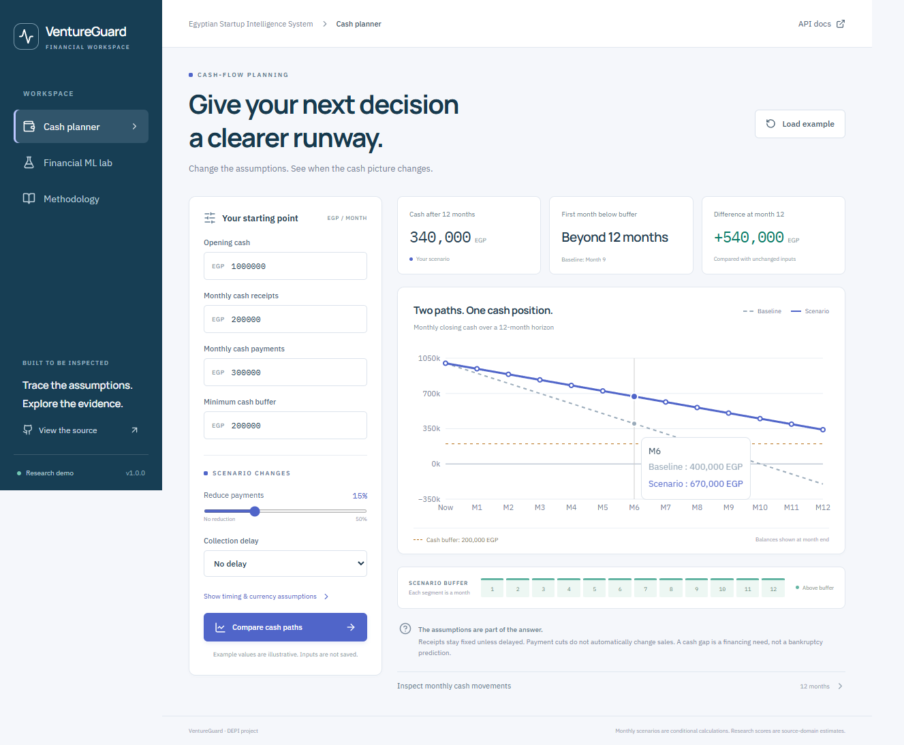

# VentureGuard

**Financial ML research and cash-flow scenario planning**, built as a component of the Egyptian Startup Intelligence System DEPI project. **RAG integration is deferred to a future release.**

VentureGuard compares classical and PyTorch models on a historical bankruptcy benchmark, investigates how missing data affects performance, and provides an independently tested cash-flow planner through FastAPI and a responsive React workspace.

Deployment status and the verified live URL are in [Deployment](docs/DEPLOYMENT.md). Measured results are in [Results](docs/RESULTS.md).



## Try the product

- **Cash planner:** start with an illustrative EGP example, change payment reductions, collection delays or FX exposure, and inspect monthly balances and financing gaps.
- **Financial ML lab:** compare 13/64-ratio schemas on historical cases. Each demo prediction uses an outer-fold model that excluded that case from training and selection.
- **Methodology:** inspect measured comparisons, evaluation design and limits.
- **API docs:** available at `/docs` on the running service.

The research models have **not** been validated for Egyptian startups. Cash planning is conditional accounting; it does not infer bankruptcy probabilities or causal intervention effects. Scores are not confidence estimates.

## End-to-end ML work

| Stage | Implementation |
|---|---|
| Data | Original UCI archive, pinned SHA-256, explicit target and quality audit |
| Preprocessing | Fold-local imputation, signed-log/scaling where appropriate, financial schemas |
| Models | Logistic regression, histogram gradient boosting, PyTorch residual MLP and prevalence reference |
| Evaluation | Nested grouped CV, weighted/unweighted fits, calibration, missingness ablations and stress tests |
| Interpretation | Held-out global permutation relevance, subgroup diagnostics and limitations |
| Serving | Versioned artifacts, validated FastAPI endpoints and CPU inference |
| Product | React/TypeScript workspace, cash chart, historical lab and methodology |
| Delivery | Docker, automated tests, GitHub Actions and Azure deployment configuration |

The PyTorch network has a 64-unit projection and two residual blocks with LayerNorm, GELU and dropout. Weights are exported to NumPy for lightweight serving, with numerical parity checked against PyTorch. The released model is selected by the experiment.

## Run locally

Use Python 3.12 and Node.js 22. From the repository root:

```bash
python -m venv .venv
# Activate .venv using your shell's activation command.
pip install -r requirements-runtime.txt
pip install --no-deps -e .
cd frontend
npm ci
npm run build
cd ..
uvicorn ventureguard.api:app --host 127.0.0.1 --port 8000
```

Open `http://127.0.0.1:8000`. Trusted release artifacts are included; startup does not train models or download source data. For separate UI development, run `npm run dev` in `frontend`; Vite forwards API requests to port 8000.

```bash
docker build -t ventureguard:local .
docker run --rm -p 8000:8000 ventureguard:local
```

The Docker image serves UI and API from one origin. Separate static hosting is supported using frontend `VITE_API_URL` and backend `CORS_ORIGINS`.

## Reproduce the experiment

```bash
pip install -r requirements-train.txt
pip install --no-deps -e .
python -m ventureguard.data
python -m ventureguard.training
python -m ventureguard.reporting
pytest -q
```

Training uses CPU and resumes completed experiments from `.training-cache/`. A fresh run acquires the original UCI archive. Previously explored data is not described as an untouched external test. Artifacts are in `artifacts/`; generated metrics, selections and held-out predictions are in `reports/ventureguard/`. Load model artifacts only from trusted sources.

For browser checks, start the built API/UI, then run `npm run test:e2e` in `frontend`. Local tests use installed Edge; set `CI=1` and run `npx playwright install chromium` to use Playwright Chromium. CI verifies accounting, data, exported inference, API behavior, browser flows and Docker build; full nested training is a separate reproducible experiment.

## API

| Endpoint | Purpose |
|---|---|
| `GET /health` | Readiness |
| `GET /v1/model-info` | Provenance and measured results |
| `GET /v1/examples` | Historical demo cases |
| `POST /v1/benchmark/predict` | Research score from a case ID or ratio mapping |
| `POST /v1/simulate` | Monthly cash accounting and scenario comparison |

The research endpoint accepts `schema_name` (`core13` or `full64`) and exactly one of `example_id` or `features`. The public demo does not persist submitted financial profiles. See `/docs` for request schemas and interactive examples.

## Read the evidence

- [Measured results](docs/RESULTS.md)
- [Data card and attribution](docs/DATA_CARD.md)
- [Model card](docs/MODEL_CARD.md)
- [Mathematical decisions](docs/MATH_NOTES.md)
- [Architecture](docs/ARCHITECTURE.md)
- [Azure deployment](docs/DEPLOYMENT.md)
- [Original parent-project plan](docs/ORIGINAL_PROJECT_PLAN.md)

Earlier Spain, Taiwan and dataset-feasibility work remains in the research folders. It is not independent validation of this release. Original UCI data: Sebastian Tomczak (2016), [DOI 10.24432/C5F600](https://doi.org/10.24432/C5F600), CC BY 4.0. Derived demo cases and experiment outputs retain this attribution.
