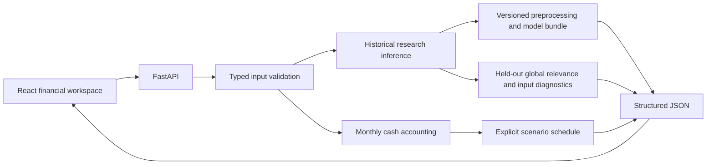

# Architecture

No LLM, document retrieval, vector database, embeddings, chat, agent router or RAG is implemented in v1. RAG integration is deferred to the parent Egyptian Startup Intelligence System roadmap.

## Training versus serving

Training acquires the original archive, freezes grouped splits, runs nested evaluation and exports a final estimator plus outer-fold bundles. The six outcome-stratified demo cases are fixed random illustrations; they do not estimate prevalence. Their displayed predictions use the excluded outer fold's model. Full-data release estimates are never described as held-out demo predictions.

Serving loads trusted local artifacts once at startup, with no training or dataset download. Numerical operations do not call third-party services. Payloads are validated and bounded; unknown fields and nonfinite values are rejected. The public demo uses one worker, a process-wide POST request cap and a 64 KB body limit. These controls bound this demo; they are not multi-tenant enterprise authentication or a distributed rate limiter.

## UI and hosting

The React build can be served from the same Docker image as the API, avoiding cross-origin setup. It can also be independently hosted on Azure Static Web Apps by setting `VITE_API_URL` during build and adding the exact frontend origin to backend `CORS_ORIGINS`. Neither pattern puts credentials in frontend code.

The cash planner has no ML probability output. Its 12-month UI example is illustrative; the API supports 1–36 explicitly supplied months. Monthly endpoint balances cannot identify intramonth shortages. Collection delays beyond the horizon are separately reported.
